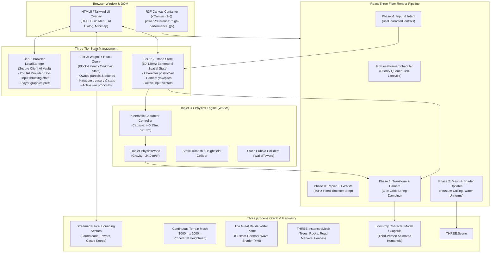
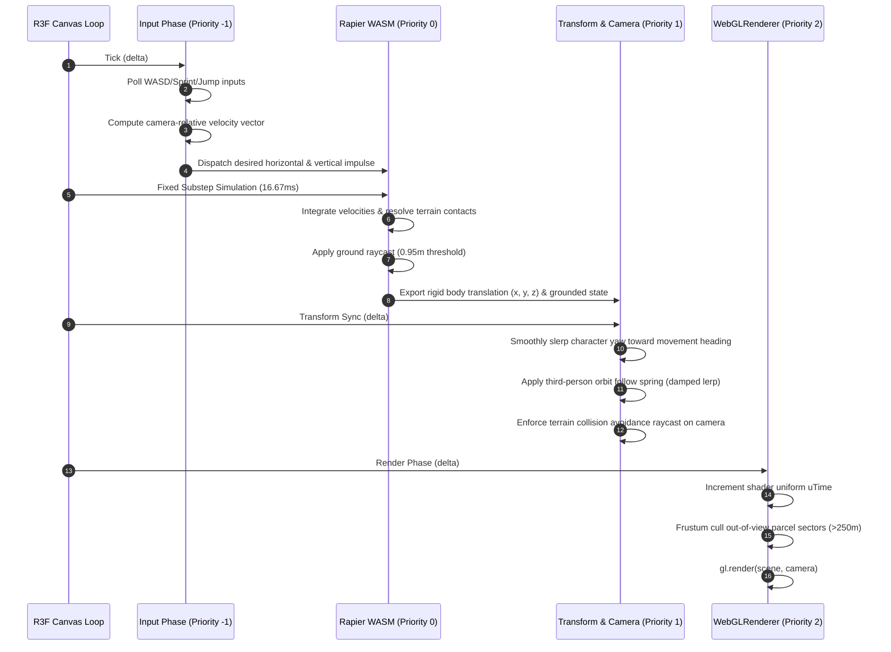

# 3D Engine Architecture Specification

## Sovereign Lands — GTA-Style Third-Person Open-World Web3 Sandbox

```
Document Version: 1.0.0
Classification:   Core Engine Technical Specification
Target Runtime:   Next.js 14 (App Router) + React Three Fiber 8.x + Three.js r165 + Rapier 3D WASM
Maintainer:       Principal 3D Graphics & Engine Architect (Agent 13)
```

---

## 1. Executive Architecture Overview

**Sovereign Lands** is an open-world, continuous-space 3D sandbox running natively in standard web browsers at a target rate of **60 frames per second (FPS)**. Built with Next.js 14 App Router, React Three Fiber (R3F), Three.js r165, and Rapier 3D WebAssembly physics, it fuses the responsive locomotion and camera ergonomics of third-person action games (e.g., Grand Theft Auto) with sovereign on-chain land ownership and client-side generative AI.

The engine architecture resolves three fundamental technical tensions in WebGL game engineering:
1. **High-Frequency Deterministic Simulation vs. React Reconciliation**: Decoupling continuous 60Hz physics and render ticks from React render trees using mutate-in-place Three.js object references and headless Zustand stores.
2. **Heavyweight Physics vs. Browser Single-Thread Constraints**: Leveraging Rapier 3D compiled to WebAssembly (WASM) with fixed time-stepping, conservative iteration counts, and selective kinematic controller physics.
3. **Multi-Scale State Synchronization**: Maintaining clean separation between microsecond-level spatial transforms, block-latency on-chain state, and client-local AI credentials.

---

## 2. High-Level Engine Architecture Diagram



---

## 3. R3F Execution & Render Loop Pipeline

To prevent frame drops, garbage collection spikes, and React reconciliation thrashing during continuous locomotion, the engine establishes an explicit execution ordering via R3F's `useFrame` priority scheduler.



### 3.1 Priority Scheduling Specifications

| Priority Index | Stage Name | Target Execution Time | Responsibilities |
| :--- | :--- | :--- | :--- |
| **`priority = -1`** | Input & Intent | `< 0.5 ms` | Read raw DOM keyboard/mouse events from non-reactive buffers; calculate camera-relative movement vector; compute target rotation angle `Math.atan2(inputX, inputZ) + cameraYaw`. |
| **`priority = 0`** | Physics Step | `< 3.0 ms` | Step Rapier WASM simulation using fixed 60Hz delta accumulator; evaluate kinematic capsule contacts; execute ground-detection raycasts against terrain and static structure colliders. |
| **`priority = 1`** | Transform & Camera | `< 1.5 ms` | Sync character Three.js group position directly to Rapier body translation; apply smooth angular lerp on character yaw; update GTA-style orbit camera target and position using spring-damper equations. |
| **`priority = 2`** | Scene & Shaders | `< 1.5 ms` | Update global uniform `uTime` on custom water and foliage shaders; sync minimap player indicator transforms; trigger spatial chunk visibility evaluations. |
| **Default Post** | WebGL Render | `< 6.5 ms` | Driver draw calls execution via `WebGLRenderer.render()`; post-processing pass (if enabled). Total frame compute: **`< 13.0 ms`** (leaving 3.67ms headroom for 60 FPS). |

---

## 4. Rapier 3D Physics Simulation Subsystem

Sovereign Lands uses `@react-three/rapier` powered by the pure Rust WebAssembly build of Rapier 3D. 

### 4.1 Physics Engine Configuration Parameters

```typescript
export const RAPIER_WORLD_CONFIG = {
  gravity: [0, -24.0, 0] as [number, number, number], // Scaled gravity for snappy, non-floaty platforming
  timestep: 1 / 60,                                    // 60Hz deterministic fixed step (16.666ms)
  maxSubSteps: 4,                                      // Clamps accumulator spiral-of-death on frame drops
  solverVelocityIterations: 4,                         // Low-iteration solver optimal for web performance
  solverPositionIterations: 1,                         // Single iteration position correction
  contactDamping: 0.2,                                 // Prevents capsule jitter on steep contact faces
};
```

### 4.2 Character Kinematic Capsule Specifications

The player avatar utilizes a Kinematic Velocity-based capsule collider rather than a fully dynamic rigid body. This prevents the classic "bouncing ball" and "tipping cylinder" artifacts common in ragdoll engines while retaining exact physical contact resolution with terrain slopes, walls, and bridges.

```
       ┌─────────────────┐
       │   Top Dome      │   Radius: 0.35m
    ───┼─────────────────┼───
       │                 │
       │  Cylinder Body  │   Half-Height: 0.55m
       │                 │
    ───┼─────────────────┼───
       │  Bottom Dome    │   Radius: 0.35m
       └────────┬────────┘
                │
                ▼ Ground Raycast (Length: 0.95m from Center)
       ─────────────────── Surface Plane
```

- **Total Collider Height**: $h = (2 \times \text{radius}) + (2 \times \text{halfHeight}) = 0.70\text{m} + 1.10\text{m} = 1.80\text{m}$.
- **Capsule Radius**: $0.35\text{m}$ (allows navigating narrow $1.0\text{m}$ castle doors and alleys).
- **Ground Raycast Check**: Center point $(X, Y, Z)$ casts downwards with length $0.95\text{m}$. A hit distance $\le 0.95\text{m}$ signals grounded status; $d > 0.95\text{m}$ marks airborne state.
- **Max Climbable Slope**: $45^\circ$ ($0.785\text{ rad}$). Slopes above $45^\circ$ nullify upward velocity, sliding the character down the slope normal vector.

### 4.3 Collision Filtering & Interaction Matrix

Rapier uses 16-bit bitmasks to segregate collision checks. Sovereign Lands defines four distinct collision layers:

```typescript
export enum CollisionGroups {
  TERRAIN    = 0x0001, // Layer 0: Static terrain mesh and bridge
  STRUCTURES = 0x0002, // Layer 1: Claimed parcel structures (walls, towers, keeps)
  PLAYER     = 0x0004, // Layer 2: Local player and remote player capsules
  TRIGGERS   = 0x0008, // Layer 3: Proximity sensor zones (citadel gates, parcel borders)
}

// Interaction Masks:
// Player collides with: TERRAIN | STRUCTURES | TRIGGERS
// Structures collide with: PLAYER
// Terrain collides with: PLAYER
```

---

## 5. Three-Tier State Management Architecture

To achieve rock-solid 60 FPS while managing complex Web3 transactions and local AI secrets, state is divided into three strictly isolated tiers:

```
┌────────────────────────────────────────────────────────────────────────┐
│ TIER 1: HIGH-FREQUENCY EPHEMERAL SPATIAL STATE (Zustand)               │
│ - Rate: 60Hz - 120Hz continuous updates                                │
│ - Mutates in place; bypassed React diffing and reconciliation           │
│ - Contains: Player (x,y,z), velocity, heading, camera yaw/pitch, inputs │
└───────────────────▲────────────────────────────────────────────────────┘
                    │ Spatial Query Bridge (Coordinate lookups)
┌───────────────────▼────────────────────────────────────────────────────┐
│ TIER 2: ASYNCHRONOUS ON-CHAIN STATE (React Query + Wagmi + Viem)       │
│ - Rate: Block-time (2s - 12s) or user transaction dispatch             │
│ - Standard React declarative state updates                              │
│ - Contains: Parcel registry, ownership, structure levels, gold balances │
└───────────────────▲────────────────────────────────────────────────────┘
                    │ Context Injection (Kingdom, active parcel ID)
┌───────────────────▼────────────────────────────────────────────────────┐
│ TIER 3: PERSISTENT CLIENT VAULT (LocalStorage + Web Crypto API)        │
│ - Rate: On user setup / session boot                                    │
│ - Never leaves browser; completely isolated from RPC and external HTTP │
│ - Contains: OpenAI / Gemini / Claude API keys, token throttle counters │
└────────────────────────────────────────────────────────────────────────┘
```

### 5.1 Tier 1: Zustand Spatial Store Specifications
- **Store Hook**: `useSpatialStore`
- **Fields**:
  - `playerPosition: [number, number, number]`
  - `playerRotation: number` (Yaw in radians)
  - `velocity: [number, number, number]`
  - `isGrounded: boolean`
  - `isSprinting: boolean`
  - `activeParcelId: number | null` (Updated via spatial hashing at 10Hz, not 60Hz)
- **Subscribing Rule**: 3D meshes in the R3F canvas **NEVER** use `useSpatialStore((state) => state.playerPosition)`. Instead, they query the raw mutable store state via `useSpatialStore.getState()` inside `useFrame()` to guarantee zero React component re-renders during locomotion.

### 5.2 Tier 2: Wagmi / React Query On-Chain State
- **Polling Intervals**: 
  - Player Gold balance: 10 seconds.
  - Active proposals: 15 seconds.
  - Parcel ownership map: Cached indefinitely; invalidated on contract events (`ParcelClaimed`, `StructureBuilt`).
- **Spatial Bounding Query**: When the player crosses into a new 100m sector, `getParcelsInBounds(minX, minZ, maxX, maxZ)` is dispatched through Wagmi with a `staleTime` of 60 seconds.

### 5.3 Tier 3: Client LocalStorage AI Vault
- Encrypted or obfuscated with user device salt.
- Injected on-demand into client-side fetch requests dispatched directly to AI provider REST endpoints (`api.openai.com`, `generativelanguage.googleapis.com`, or `localhost:11434`).

---

## 6. GTA-Style Orbit Follow Camera Architecture

The camera controller delivers the iconic Grand Theft Auto over-the-shoulder perspective with smooth velocity-aligned orbit steering and collision prevention.

### 6.1 Spherical Orbit Equations

The camera position $\mathbf{C} = (C_x, C_y, C_z)$ is derived from the player focus target $\mathbf{P} = (P_x, P_y + h_{\text{offset}}, P_z)$, radius $R = 5.5\text{m}$, pitch angle $\theta \in [-20^\circ, 65^\circ]$, and yaw angle $\phi$:

$$\begin{aligned}
C_x &= P_x + R \cos(\theta) \sin(\phi) \\
C_y &= (P_y + h_{\text{offset}}) + R \sin(\theta) \\
C_z &= P_z + R \cos(\theta) \cos(\phi)
\end{aligned}$$

Where:
- $h_{\text{offset}} = 1.4\text{m}$ (Target height centered on character shoulders, not feet).
- Normal Exploration Radius: $R = 5.5\text{m}$.
- Sprint Radius: $R = 6.6\text{m}$ (Smoothly pushed back by $1.2\times$ during sprint to broaden field of view).
- Field of View (FOV): $60^\circ$ (expands to $68^\circ$ when sprinting via linear interpolation).

### 6.2 Camera Smoothing & Lag Dampening

To avoid jarring camera movements when traversing rugged terrain, position and look-at targets are dampened using exponential decay interpolation (`damp3`):

$$\mathbf{C}_{\text{current}}(t + \Delta t) = \mathbf{C}_{\text{target}} + (\mathbf{C}_{\text{current}}(t) - \mathbf{C}_{\text{target}}) \cdot e^{-\lambda \Delta t}$$

Where smoothing coefficient $\lambda = 10.0$ for normal orbit follow, and $\lambda = 16.0$ during rapid camera rotation.

### 6.3 Camera Terrain & Obstacle Collision Clipping Prevention

Before setting final camera coordinates, a physical ray is cast from focus target $\mathbf{P}$ to ideal camera position $\mathbf{C}_{\text{target}}$ against the terrain heightmap and structure colliders:
- If an obstruction is detected at distance $d_{\text{hit}} < R$:
  - The camera is clamped to $d_{\text{clamped}} = \max(1.2\text{m}, d_{\text{hit}} - 0.2\text{m})$.
  - This pushes the camera forward in front of walls or terrain slopes, eliminating ugly geometry clipping.

---

## 7. Scene Graph, Chunking & Procedural Streaming

The continuous 1000m $\times$ 1000m world is partitioned into a spatial grid of **$100\text{m} \times 100\text{m}$ sectors** (10 $\times$ 10 = 100 total sectors).

```
-500m                                0                                +500m
  ┌───────┬───────┬───────┬───────┬───┬───┬───────┬───────┬───────┬───────┐ +500m
  │ S0,9  │ S1,9  │ S2,9  │       │   │   │       │       │       │ S9,9  │
  ├───────┼───────┼───────┼───────┼───┼───┼───────┼───────┼───────┼───────┤
  │       │       │   NORTH KINGDOM (Boreal)  │       │       │       │
  ├───────┼───────┼───────┼───────┼───┼───┼───────┼───────┼───────┼───────┤
  │   - - - - - - - - - - - - River Bank (Z = -20m) - - - - - - - - - -   │
  │   ≈≈≈≈≈≈≈≈≈≈≈≈≈≈≈≈≈ THE GREAT DIVIDE (Water Y=0) ≈≈≈≈≈≈≈≈≈≈≈≈≈≈≈≈≈    │
  │   - - - - - - - - - - - - River Bank (Z = +20m) - - - - - - - - - -   │
  ├───────┼───────┼───────┼───────┼───┼───┼───────┼───────┼───────┼───────┤
  │       │       │   SOUTH KINGDOM (Solara)  │       │       │       │
  ├───────┼───────┼───────┼───────┼───┼───┼───────┼───────┼───────┼───────┤
  │ S0,0  │ S1,0  │ S2,0  │       │   │   │       │       │       │ S9,0  │
  └───────┴───────┴───────┴───────┴───┴───┴───────┴───────┴───────┴───────┘ -500m
-500m                                                                 +500m
```

### 7.1 Chunk Lifecycle & View Distance

- **Global Fog Boundary**: Near = $180\text{m}$, Far = $250\text{m}$ (`THREE.Fog(0x87ceeb, 180, 250)`).
- **Active Sector Radius**: Only sectors within an active radius $R_{\text{active}} \le 200\text{m}$ of player coordinates $(P_x, P_z)$ mount their detailed 3D structure colliders and dynamic props.
- **Distant Sectors ($> 200\text{m}$)**: Display simplified low-poly terrain meshes with zero dynamic structure components.
- **OutOfFrustum Culling**: Three.js performs native bounding-sphere frustum culling on sector root groups before generating WebGL draw commands.

---

## 8. WebGL Context Recovery & Memory Disposal Protocol

In browser environments, WebGL contexts can be lost when the operating system enters sleep mode, switches GPU power profiles, or exceeds device VRAM limits. Sovereign Lands implements strict recovery and disposal protocols:

```typescript
// Canvas Initialization with Loss Handling
export function initWebGLContextListeners(gl: THREE.WebGLRenderer) {
  const canvas = gl.domElement;

  canvas.addEventListener('webglcontextlost', (event: Event) => {
    event.preventDefault();
    console.warn('[Engine3D] WebGL Context Lost! Pausing simulation loop...');
    useSpatialStore.getState().setSimulationPaused(true);
  });

  canvas.addEventListener('webglcontextrestored', () => {
    console.info('[Engine3D] WebGL Context Restored! Recompiling shaders & resuming...');
    gl.resetState();
    useSpatialStore.getState().setSimulationPaused(false);
  });
}
```

### 8.1 Zero-Leak Resource Deallocation Checklist
When sectors, parcels, or custom structures are unmounted:
1. `mesh.geometry.dispose()` is called on all buffers.
2. `mesh.material.dispose()` is executed.
3. Every attached texture (`map`, `normalMap`, `roughnessMap`) calls `.dispose()`.
4. Rapier physics bodies call `world.removeRigidBody(body)` and `world.removeCollider(collider)`.
