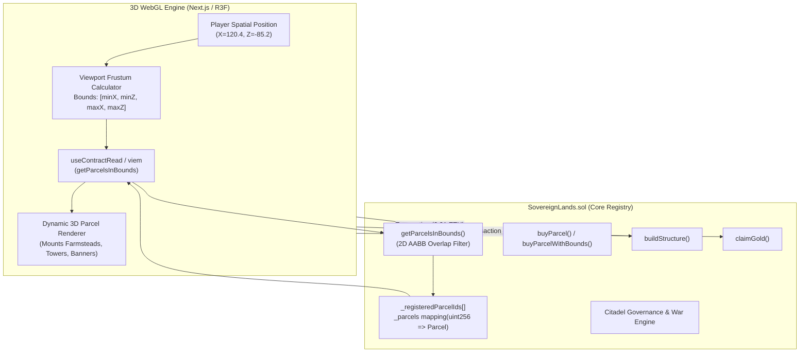

# Smart Contract Spatial API & On-Chain Integration Specification

## Sovereign Lands — 3D Land Registry, Spatial Queries & Gas Economics

```
Document Version: 1.0.0
Classification:   Smart Contract Spatial Architecture & Integration API
Target Contracts: contracts/src/SovereignLands.sol (ISovereignLands, Types)
Solidity Version: ^0.8.20 (EVM / Base / Ethereum Sepolia)
Maintainer:       Principal 3D Graphics & Engine Architect (Agent 13)
```

---

## 1. Executive Summary & Architecture

The **Sovereign Lands** smart contract ecosystem transforms continuous 3D world space into sovereign, decentralized territory. Unlike 2D grid NFT projects, Sovereign Lands provides a continuous **3D Axis-Aligned Bounding Box (AABB)** spatial query engine directly in Solidity, allowing the client WebGL engine to stream, filter, and render parcels based on player coordinates and view distance.



---

## 2. Core Spatial Types & Data Structures (`Types.sol`)

### 2.1 The Spatial Bounding Box: `ParcelBoundingBox`

The coordinate boundary of every sovereign plot in the 3D world is stored as four 32-bit signed integers representing real-world meters:

```solidity
struct ParcelBoundingBox {
    int32 minX; // Westernmost coordinate boundary (-500m to +500m)
    int32 minZ; // Northernmost coordinate boundary (-500m to +500m)
    int32 maxX; // Easternmost coordinate boundary (-500m to +500m)
    int32 maxZ; // Southernmost coordinate boundary (-500m to +500m)
}
```

- **Invariants**: 
  - $\text{maxX} > \text{minX}$ (Width $\ge 20\text{m}$).
  - $\text{maxZ} > \text{minZ}$ (Depth $\ge 20\text{m}$).
  - $\text{minX}, \text{maxX}, \text{minZ}, \text{maxZ} \in [-500, +500]$.

### 2.2 The Complete Parcel Entity: `Parcel`

```solidity
struct Parcel {
    uint256 id;                 // Unique ERC-721 token identifier
    ParcelBoundingBox bounds;   // Continuous 3D world bounding box (meters)
    Kingdom kingdom;            // North (1), South (2), or None (0)
    address owner;              // Registered landowner address (or address(0))
    StructureType structure;    // None (0), Farmstead (1), GuardTower (2), StoneWall (3), CastleKeep (4)
    uint256 lastHarvestTime;    // UNIX timestamp of last tax/gold collection
    uint256 defenseRating;      // Defensive fortification rating
    uint256 attackRating;       // Military attack projection power
}
```

### 2.3 Kingdom & Structure Enumerations

```solidity
enum Kingdom { None, North, South }

enum StructureType { 
    None,        // 0: Unimproved wild territory
    Farmstead,   // 1: 50 Gold | +5 Gold/min passive income
    GuardTower,  // 2: 80 Gold | +8 Defense rating
    StoneWall,   // 3: 60 Gold | +6 Defense rating
    CastleKeep   // 4: 150 Gold | +10 Attack rating, +5 Defense rating
}
```

---

## 3. Spatial Query Engine: `getParcelsInBounds`

The primary bridge between the blockchain and the 3D graphics engine is the spatial bounding query:

```solidity
function getParcelsInBounds(
    int32 minX,
    int32 minZ,
    int32 maxX,
    int32 maxZ
) external view returns (Parcel[] memory);
```

### 3.1 Mathematical AABB Intersection Test
Two 2D axis-aligned bounding boxes $A = (\text{minX}_A, \text{minZ}_A, \text{maxX}_A, \text{maxZ}_A)$ and $B = (\text{minX}_B, \text{minZ}_B, \text{maxX}_B, \text{maxZ}_B)$ intersect if and only if they overlap on both axes:

$$\text{Overlap}(A, B) \iff \neg \left( \text{maxX}_A < \text{minX}_B \lor \text{minX}_A > \text{maxX}_B \lor \text{maxZ}_A < \text{minZ}_B \lor \text{minZ}_A > \text{maxZ}_B \right)$$

### 3.2 Two-Pass Gas-Efficient Allocation
Because Solidity memory arrays cannot dynamically resize without expensive reallocation, `getParcelsInBounds` uses an optimized two-pass scan:
1. **Pass 1 (Counting)**: Evaluates bounding box intersections across registered parcels to determine exact `matchCount`.
2. **Allocation**: Allocates `new Parcel[](matchCount)` in memory with zero unused slots.
3. **Pass 2 (Collection)**: Populates the memory array and returns it to the client.

---

## 4. External Method Specifications & Gas Estimates

Transactions on EVM networks incur gas based on state storage modifications (`SSTORE`), cryptographic hashing, and compute complexity. The table below outlines empirical gas profiles on Ethereum L2 (Base / Arbitrum):

| Function Signature | Type | Gas Estimate (Min - Max) | State Modifications |
| :--- | :--- | :--- | :--- |
| `buyParcel(uint256 parcelId)` | Payable | $82,000 - 95,000$ | ERC721 `_safeMint`, creates parcel record, credits 100 starter gold, assigns kingdom. |
| `buyParcelWithBounds(uint256 id, int32 minX, ...)` | Payable | $88,000 - 105,000$ | Validates custom bounding box, checks overlap, mints NFT. |
| `buildStructure(uint256 parcelId, StructureType structure)` | Non-payable | $52,000 - 68,000$ | Verifies ownership, deducts player gold balance, updates structure enum, recalculates attack/defense. |
| `claimGold()` | Non-payable | $44,000 - 95,000$ | Iterates owned parcels with Farmsteads, computes elapsed time, transfers 10% tax to kingdom treasury, credits net gold to player. |
| `propose(Kingdom kingdom, ProposalType type, ...)` | Non-payable | $75,000 - 110,000$ | Verifies player owns parcels in kingdom, stores proposal description and parameters, sets voting timer. |
| `vote(uint256 proposalId, bool support)` | Non-payable | $48,000 - 62,000$ | Calculates voter's parcel count for voting weight, tallies votes, prevents double voting. |
| `executeProposal(uint256 proposalId)` | Non-payable | $55,000 - 85,000$ | Checks quorum, updates kingdom tax rate or executes treasury dividend. |
| `resolveWar(Kingdom attackerKingdom)` | Non-payable | $65,000 - 115,000$ | Compares total Attack vs Defender Defense, loots 25% treasury if attacker wins, records WarResult. |
| `getParcelsInBounds(minX, minZ, maxX, maxZ)` | View (RPC) | **$0\text{ Gas}$** (Client) / $\approx 15\text{k}$ equiv. per 10 parcels | Reads memory storage; filtered off-chain via standard `eth_call`. |

---

## 5. Event Architecture & Subgraph / WebSocket Subscriptions

Real-time 3D world updates are driven by smart contract events emitted during state transitions:

```solidity
event ParcelRegistered(uint256 indexed parcelId, Kingdom indexed kingdom, int32 minX, int32 minZ, int32 maxX, int32 maxZ);
event ParcelClaimed(uint256 indexed parcelId, address indexed owner, Kingdom indexed kingdom, ParcelBoundingBox bounds);
event StructureBuilt(uint256 indexed parcelId, address indexed owner, StructureType structure, uint256 defenseRating, uint256 attackRating);
event GoldHarvested(address indexed player, uint256 grossGold, uint256 netGold, uint256 taxPaid);
event ProposalCreated(uint256 indexed proposalId, Kingdom indexed kingdom, ProposalType proposalType, uint256 param, string description, address indexed proposer, uint256 endTime);
event VoteCast(uint256 indexed proposalId, address indexed voter, bool support, uint256 weight);
event ProposalExecuted(uint256 indexed proposalId, bool passed);
event WarDeclared(Kingdom indexed attacker, Kingdom indexed defender);
event WarResolved(Kingdom indexed attacker, Kingdom indexed defender, uint256 attackerAttack, uint256 defenderDefense, bool attackerWon, uint256 goldPlundered);
```

### 5.1 Event Indexing & Client Update Pattern

```typescript
// Viem / Wagmi Real-Time Event Listener Standard
import { useWatchContractEvent } from 'wagmi';
import { SOVEREIGN_LANDS_ABI, SOVEREIGN_LANDS_ADDRESS } from '@/lib/web3/contracts';

export function useRealtimeWorldSync(onStructureBuilt: (parcelId: number, structure: number) => void) {
  useWatchContractEvent({
    address: SOVEREIGN_LANDS_ADDRESS,
    abi: SOVEREIGN_LANDS_ABI,
    eventName: 'StructureBuilt',
    onLogs(logs) {
      for (const log of logs) {
        const { parcelId, structure } = log.args;
        console.log(`[WorldSync] In-world structure updated: Parcel #${parcelId} -> ${structure}`);
        onStructureBuilt(Number(parcelId), Number(structure));
      }
    },
  });
}
```

---

## 6. Client Web3 Viewport Chunking Strategy

To prevent excessive RPC payload sizes, the 3D client should **NEVER** call `getAllParcels()` continuously during gameplay. Instead, it utilizes **Viewport Frustum Chunking**:

```typescript
export function computeViewportBounds(
  playerX: number,
  playerZ: number,
  viewDistance = 200 // meters
): { minX: number; minZ: number; maxX: number; maxZ: number } {
  return {
    minX: Math.max(-500, Math.floor(playerX - viewDistance)),
    minZ: Math.max(-500, Math.floor(playerZ - viewDistance)),
    maxX: Math.min(500, Math.ceil(playerX + viewDistance)),
    maxZ: Math.min(500, Math.ceil(playerZ + viewDistance)),
  };
}
```

### 6.1 RPC Caching & Invalidation Rules
1. **Cache TTL**: Parcel spatial results are cached client-side for **$60\text{ seconds}$** using TanStack React Query (`staleTime: 60_000`).
2. **Invalidation**: A sector cache entry is invalidated **ONLY** when a relevant `StructureBuilt` or `ParcelClaimed` event is received via WebSocket for a parcel located within those bounds.
3. **Optimistic Updates**: When the local player constructs a building, the 3D mesh is mounted immediately in the local scene graph before block confirmation; if the transaction reverts, the ghost preview is restored.
