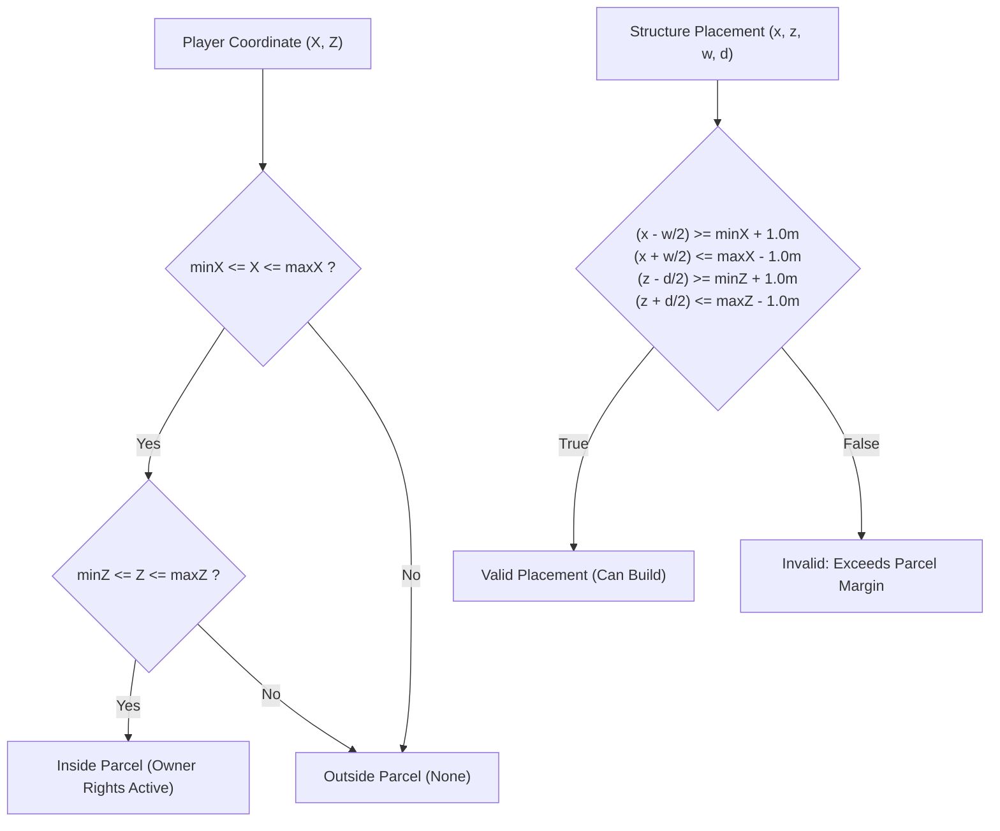

# Spatial Coordinate System & Mathematical Geometry Specification

## Sovereign Lands — Continuous 3D World Space & On-Chain Quantization

```
Document Version: 1.0.0
Classification:   Spatial Mathematics & Geometry Specification
Standard Metric:  1.0 Three.js World Unit = 1.0 Real-World Meter (SI)
Maintainer:       Principal 3D Graphics & Engine Architect (Agent 13)
```

---

## 1. Dimensional Units & Coordinate Frame Conventions

Sovereign Lands operates on a right-handed Cartesian coordinate system consistent with standard WebGL and Three.js conventions:

```
                  +Y (Elevation / Up)
                   │
                   │
                   │
                   └─────────── +X (East / Bridge Cross Axis)
                  ╱
                 ╱
                ╱
              +Z (South Kingdom / Solara)
```

### 1.1 Metric Equivalence
- **Unit Scale**: Exactly **$1.0\text{ WebGL Unit} = 1.0\text{ Meter}$** in real-world metric scale.
- **Player Avatar Dimensions**: Height $= 1.80\text{m}$, Shoulder Width $= 0.70\text{m}$.
- **Horizontal Locomotion Speeds**:
  - Walk Speed: $v_{\text{walk}} = 5.2\text{ m/s}$ ($18.72\text{ km/h}$).
  - Sprint Speed: $v_{\text{sprint}} = 9.36\text{ m/s}$ ($33.70\text{ km/h}$, $1.8\times$).
  - Backpedal Multiplier: $0.70\times$ ($3.64\text{ m/s}$).
  - Strafe Multiplier: $0.85\times$ ($4.42\text{ m/s}$).
- **Gravitational Acceleration**: $g = -24.0\text{ m/s}^2$ (tuned for responsive arcade jump arc without excessive float time).
- **Jump Impulse**: $J_y = +7.2\text{ m/s}$, producing an apex jump height of $\approx 1.08\text{m}$.

---

## 2. World Coordinate Bounds & Origin Anchor

### 2.1 The Global Origin $(0, 0, 0)$
The global world origin $(0, 0, 0)$ is situated precisely at the geometric center of **The Great Divide Bridge**:
- **$X = 0.0$**: Center line of the north-south stone causeway.
- **$Y = 1.80$**: Deck apex elevation of the arch bridge above water level ($Y = 0.0$).
- **$Z = 0.0$**: Center of the territorial frontier dividing the Northern and Southern Kingdoms.

### 2.2 Global World Domain Limits
The playable world map spans a continuous $1000\text{m} \times 1000\text{m}$ area:

$$\Omega = \left\{ (X, Y, Z) \in \mathbb{R}^3 \;\middle|\; X \in [-500, +500],\; Z \in [-500, +500],\; Y = f_{\text{terrain}}(X, Z) \right\}$$

```
                   NORTH KINGDOM (Boreal Citadel)
                   Z ∈ [-500m, -20m]
                   Highlands, snow-dusted crags, rocky citadels
▲ -Z (North)
│
│                  THE GREAT DIVIDE FRONTIER
│                  Z ∈ [-20m, +20m]
┼ (0,0,0) ───────  The Great Divide River Basin (Water Y = 0.0m)
│                  Central Bridge: |X| < 8m, |Z| < 28m
│
│                  SOUTH KINGDOM (Solara Citadel)
▼ +Z (South)       Z ∈ [+20m, +500m]
                   Sunlit meadows, fertile lowlands, sprawling estates

◄──────────────────────────────────────────────────────────────────►
-X = -500m (West Coastline)               +X = +500m (East Mountains)
```

---

## 3. Procedural Terrain Elevation Function: $f_{\text{terrain}}(X, Z)$

The vertical coordinate $Y$ is a continuous piecewise function that guarantees analytical continuity across all territorial zones:

$$Y = f_{\text{terrain}}(X, Z)$$

### 3.1 Zone 1: The Great Divide Arch Causeway ($|X| < 8\text{m} \land |Z| < 28\text{m}$)
The bridge forms a parabolic vertical curve joining the two river bluffs at $Y = 1.2\text{m}$ with an arch crown at $Y = 1.8\text{m}$:

$$f_{\text{bridge}}(Z) = 1.80 - 0.60 \cdot \left(\frac{Z}{25}\right)^2$$

- At $Z = 0\text{m}$: $Y = 1.80\text{m}$ (Bridge Apex).
- At $Z = \pm 20\text{m}$: $Y = 1.416\text{m}$.
- At $Z = \pm 25\text{m}$: $Y = 1.20\text{m}$ (Bluff Roadway Junction).

### 3.2 Zone 2: The Great Divide River Channel ($|Z| \le 20\text{m} \land |X| \ge 8\text{m}$)
The river channel cuts a smooth parabolic depression with maximum depth at $Z = 0$ ($Y = -2.2\text{m}$) and bluffs rising to $Y = 0.8\text{m}$ at $Z = \pm 20\text{m}$:

Let normalized distance $t = \frac{|Z|}{20.0} \in [0, 1]$:

$$f_{\text{river}}(Z) = y_{\text{bed}} + (y_{\text{bank}} - y_{\text{bed}}) \cdot t^2 = -2.20 + (0.80 - (-2.20)) \cdot t^2 = -2.20 + 3.00 \cdot t^2$$

- Water Surface Plane: Fixed at $Y_{\text{water}} = 0.00\text{m}$.
- Riverbed Center ($Z = 0$): $Y = -2.20\text{m}$ (Water depth $= 2.20\text{m}$).
- Riverbank Crest ($Z = \pm 20$): $Y = +0.80\text{m}$ (Bluff clearance above water $= 0.80\text{m}$).

### 3.3 Zone 3: North Kingdom Highlands ($Z < -20\text{m}$)
The northern realm features rugged, ascending alpine terrain:

$$f_{\text{north}}(X, Z) = \max\left(0.60,\; 0.80 + S_{\text{north}}(Z) + H_{\text{north}}(X, Z)\right)$$

Where:
- Base Slope: $S_{\text{north}}(Z) = \left(\frac{|Z| - 20}{400}\right) \times 8.00\text{m}$.
- Harmonic Undulations:
  $$H_{\text{north}}(X, Z) = 4.5 \sin(0.015 X) \cos(0.02 Z) + 2.2 \sin(0.04 X + 1.2) \cos(0.03 Z) + 3.0 |\sin(0.01(X + Z))|$$

### 3.4 Zone 4: South Kingdom Lowlands ($Z > +20\text{m}$)
The southern territory features sweeping, rolling fertile meadows:

$$f_{\text{south}}(X, Z) = \max\left(0.60,\; 0.80 + S_{\text{south}}(Z) + H_{\text{south}}(X, Z)\right)$$

Where:
- Base Slope: $S_{\text{south}}(Z) = \left(\frac{Z - 20}{400}\right) \times 5.50\text{m}$.
- Harmonic Undulations:
  $$H_{\text{south}}(X, Z) = 3.5 \sin(0.018 X) \cos(0.015 Z) + 1.8 \cos(0.035 X - 0.02 Z)$$

---

## 4. On-Chain Bounding Box Schema & Fixed-Point Quantization

In continuous 3D game engines, spatial positions are represented as 32-bit IEEE 754 floating-point coordinates (`Float32Array`). In Ethereum Virtual Machine (EVM) smart contracts, floating-point math is avoided to eliminate non-deterministic rounding and excessive gas overhead.

Sovereign Lands bridges this with a **1:1 Meter Integer Quantization Scheme**:

### 4.1 Solidity Spatial Structs (`Types.sol`)

```solidity
struct ParcelBoundingBox {
    int32 minX; // Western boundary (meters)
    int32 minZ; // Northern boundary (meters)
    int32 maxX; // Eastern boundary (meters)
    int32 maxZ; // Southern boundary (meters)
}
```

### 4.2 Quantization & Dequantization Functions

$$\begin{aligned}
\text{To On-Chain (Meters)}: &\quad \text{coord}_{\text{solidity}} = \text{round}(\text{coord}_{\text{webgl}}) \\
\text{To WebGL (Float)}:    &\quad \text{coord}_{\text{webgl}} = \text{float32}(\text{coord}_{\text{solidity}})
\end{aligned}$$

Because $1\text{ unit} = 1\text{ meter}$, rounding to the nearest integer achieves an on-chain spatial resolution of exactly **$1.0\text{ meter}$**, while the client-side game engine renders continuous movements down to millimeter precision ($10^{-3}\text{m}$).

### 4.3 Standard Parcel Dimensions
Standard land plots are sized at $50\text{m} \times 50\text{m}$ ($2,500\text{ m}^2$ area):
- $\Delta X = \text{maxX} - \text{minX} = 50\text{m}$.
- $\Delta Z = \text{maxZ} - \text{minZ} = 50\text{m}$.
- Minimum Parcel Size: $20\text{m} \times 20\text{m}$ ($400\text{ m}^2$).
- Maximum Estate Parcel Size: $100\text{m} \times 100\text{m}$ ($10,000\text{ m}^2$).

---

## 5. Spatial Inclusion & Boundary Validation Algorithms



### 5.1 Point-In-Bounds Test (`isPointInBounds`)
A continuous point $P = (X, Z)$ is strictly inside parcel $\mathcal{B} = (\text{minX}, \text{minZ}, \text{maxX}, \text{maxZ})$ if and only if:

$$\text{isPointInBounds}(X, Z, \mathcal{B}) \iff (\text{minX} \le X \le \text{maxX}) \land (\text{minZ} \le Z \le \text{maxZ})$$

### 5.2 Structure Setback & Boundary Margin Rule
To ensure visual harmony, clear walking easements, and zero collision mesh clipping between adjacent landowner parcels, all structures must observe a **$1.0\text{m}$ boundary setback buffer**:

Given a structure with center $(P_x, P_z)$, width $W$, and depth $D$:

$$\begin{aligned}
P_x - \frac{W}{2} &\ge \text{minX} + 1.0\text{m} \\
P_x + \frac{W}{2} &\le \text{maxX} - 1.0\text{m} \\
P_z - \frac{D}{2} &\ge \text{minZ} + 1.0\text{m} \\
P_z + \frac{D}{2} &\le \text{maxZ} - 1.0\text{m}
\end{aligned}$$

### 5.3 Building Grid Snapping (`snapToGrid`)
When placing structures in the 3D world, continuous cursor coordinates snap to a discrete $2.0\text{m}$ grid increment:

$$\text{snapToGrid}(u, \text{step} = 2.0) = \left\lfloor \frac{u}{\text{step}} + 0.5 \right\rfloor \times \text{step}$$

This guarantees that stone walls, towers, and gates align flush along modular building axes.

---

## 6. Territorial Sovereignty Classification

The smart contract and game engine determine kingdom affiliation via the sign of the parcel's $Z$ midpoint:

$$Z_{\text{mid}} = \frac{\text{minZ} + \text{maxZ}}{2}$$

$$\text{Kingdom}(Z_{\text{mid}}) = \begin{cases} 
\text{North (Boreal)}, & Z_{\text{mid}} < 0 \\
\text{South (Solara)}, & Z_{\text{mid}} > 0 \\
\text{Neutral / Frontier}, & Z_{\text{mid}} = 0 
\end{cases}$$

Parcels spanning the river frontier ($[-20\text{m}, +20\text{m}]$) are designated as non-claimable neutral crown territory, dedicated to public thoroughfares, bridge approaches, and open-world player skirmishes.

---

## 7. Geometric Center & Elevation Computation

The 3D centroid of any rectangular bounding parcel is computed analytically:

$$\begin{aligned}
C_x &= \frac{\text{minX} + \text{maxX}}{2} \\
C_z &= \frac{\text{minZ} + \text{maxZ}}{2} \\
C_y &= f_{\text{terrain}}(C_x, C_z)
\end{aligned}$$

The terrain height at the centroid serves as the ground-plane anchor for parcel boundary holographic markers, ownership banner poles, and structure placement baselines.
