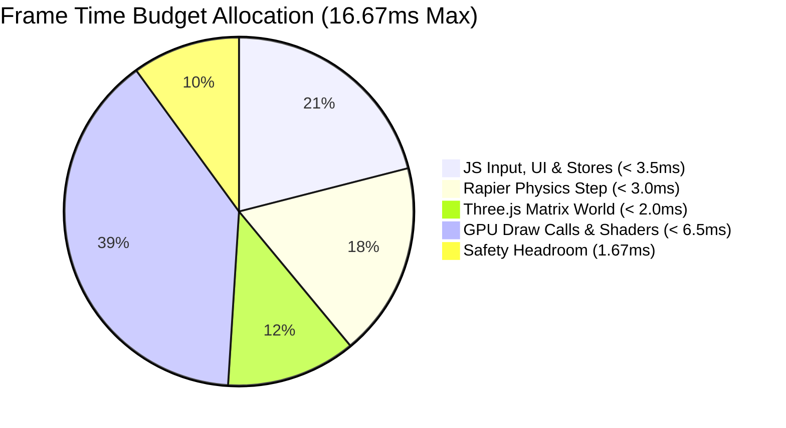
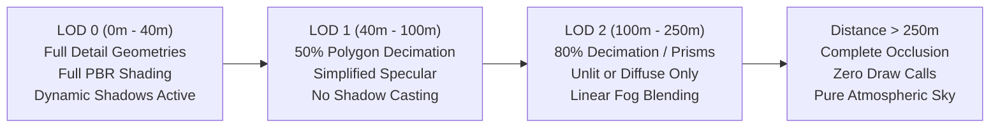

# WebGL Performance Budget & Optimization Specification

## Sovereign Lands — 60 FPS Browser Performance Envelope

```
Document Version: 1.0.0
Classification:   Graphics Engine Performance Budget & Asset Standards
Target Metric:    60.0 FPS (16.667ms frame budget) on Mid-Range Laptops & Mobile
Maintainer:       Principal 3D Graphics & Engine Architect (Agent 13)
```

---

## 1. Master Performance Envelope Summary

To achieve seamless, stutter-free 60 FPS in standard WebGL2 browsers (Chrome, Safari, Firefox, Edge) without GPU thermal throttling or memory thrashing, all 3D assets, scene components, and render passes must adhere to the following strict budgets:

| Performance Metric | Hard Ceiling (Budget) | Ideal Target (Nominal) | Measurement Tool |
| :--- | :--- | :--- | :--- |
| **Frame Rate** | $\ge 55\text{ FPS}$ | $\mathbf{60.0\text{ FPS}}$ | Chrome DevTools Performance / Stats.js |
| **Total Frame Time** | $\le 16.667\text{ ms}$ | $\mathbf{12.50\text{ ms}}$ | Performance Timeline |
| **Active WebGL Draw Calls** | $\mathbf{\le 120}$ calls/frame | $\mathbf{75 - 90}$ calls/frame | `gl.info.render.calls` / Spector.js |
| **Visible Frustum Triangles** | $\mathbf{\le 150,000}$ triangles | $\mathbf{90,000 - 110,000}$ | `gl.info.render.triangles` |
| **Total Instanced Geometries** | $\le 12$ distinct `InstancedMesh` | $6 - 8$ instanced groups | Three.js Scene Graph Audit |
| **VRAM Texture Memory** | $\mathbf{\le 45.0\text{ MB}}$ compressed | $\mathbf{28.0 - 35.0\text{ MB}}$ | WebGL Memory Tracker |
| **Geometry Buffer VRAM** | $\le 25.0\text{ MB}$ attributes | $14.0 - 18.0\text{ MB}$ | GPU Buffer Memory |
| **Draw Distance (Max)** | $\mathbf{250.0\text{ meters}}$ | $220.0\text{ meters}$ | Fog Far Distance (`THREE.Fog`) |
| **Shadow Distance (Max)** | $\mathbf{80.0\text{ meters}}$ | $60.0\text{ meters}$ | DirectionalLight Shadow Camera Bounds |

---

## 2. 16.67ms Frame Time Budget Allocation

Every 60 FPS frame has an absolute time ceiling of **$16.667\text{ milliseconds}$**. Compute time is apportioned across four discrete runtime stages:

```
┌────────────────────────────────────────────────────────────────────────┐
│ 16.667ms Frame Budget (60 FPS)                                         │
├──────────────┬──────────────┬──────────────┬───────────────────────────┤
│ JavaScript   │ Rapier 3D    │ Three.js     │ WebGL Driver Execution    │
│ Input & UI   │ Physics WASM │ Scene Update │ & GPU Fragment Shading    │
│  < 3.5ms     │   < 3.0ms    │   < 2.0ms    │        < 6.5ms            │
├──────────────┴──────────────┴──────────────┴───────────────────────────┤
│                                        ◄────── Headroom: ~1.67ms ─────►│
└────────────────────────────────────────────────────────────────────────┘
```



1. **JavaScript Engine & UI Phase ($< 3.5\text{ms}$)**:
   - Poll input events and character velocity calculation.
   - Run spatial hash queries at 10Hz (amortized over frames).
   - Sync Zustand headless stores (zero React DOM reconciliation during locomotion).
2. **Rapier 3D Physics Step ($< 3.0\text{ms}$)**:
   - Fixed 60Hz delta simulation step.
   - Kinematic character controller integration.
   - Ground raycast queries ($0.95\text{m}$).
3. **Three.js Scene Graph & Matrix Updates ($< 2.0\text{ms}$)**:
   - Synchronize character model transform from Rapier body.
   - Third-person orbit follow camera smoothing (`damp3`).
   - Frustum culling bounding-sphere calculations.
4. **WebGL Driver & GPU Shading ($< 6.5\text{ms}$)**:
   - Shadow map depth render pass (directional sun light).
   - Main scene forward rendering pass.
   - Water surface vertex distortion and reflection pass.
5. **Reserve Safety Headroom ($\approx 1.67\text{ms}$)**:
   - Prevents micro-stutter when background garbage collection or browser OS events fire.

---

## 3. Draw Call Optimization Strategy ($< 120$ Calls)

Draw calls represent the most critical CPU bottleneck in WebGL. Issuing separate draw calls for every tree, wall section, fence post, or cobblestone degrades performance rapidly.

### 3.1 Draw Call Allocation Table

| Scene Element Category | Max Allowable Calls | Architectural Batching Technique |
| :--- | :--- | :--- |
| **Terrain & Riverbed** | 4 calls | Static segmented chunk geometry with multi-texture splatting |
| **Water Surface** | 1 call | Single Gerstner wave plane with transparent forward pass |
| **Natural Flora (Trees & Rocks)** | 6 calls | 3 tree variants $\times$ 2 (`THREE.InstancedMesh` instances) |
| **Fences & Boundary Posts** | 2 calls | Single instanced mesh for stone posts, 1 for wooden rails |
| **Player Avatar (Local)** | 3 calls | Shared skinned mesh / material (Body, Armor, Weapon) |
| **Remote Multiplayer Avatars** | 12 calls | Low-poly instanced or batch-rendered avatars (Agent 17) |
| **Claimed Parcel Structures** | 45 calls | Modular prefab instances (Stone walls, towers, farmhouses) |
| **UI & Particle Effects** | 8 calls | Floating damage numbers, harvest spark sprites, dust billows |
| **Shadow Depth Passes** | 25 calls | Re-rendering shadow-casting meshes into light depth buffer |
| **Atmospheric Sky & Sun** | 2 calls | Hemispheric sky dome + procedural sun billboard |
| **Buffer Headroom** | 12 calls | Dynamic interactions or temporary building placement ghosts |
| **Total Peak Budget** | **120 calls** | **Strict ceiling enforced during continuous gameplay** |

### 3.2 InstancedMesh Implementation Standard
All repeating environmental props must use `THREE.InstancedMesh`. Individual `Mesh` components inside loops are strictly forbidden.

```typescript
// Standard Instanced Prop Generator
export function createInstancedNatureCluster(
  geometry: THREE.BufferGeometry,
  material: THREE.Material,
  count: number,
  transforms: THREE.Matrix4[]
): THREE.InstancedMesh {
  const instancedMesh = new THREE.InstancedMesh(geometry, material, count);
  instancedMesh.instanceMatrix.setUsage(THREE.StaticDrawUsage);

  for (let i = 0; i < count; i++) {
    instancedMesh.setMatrixAt(i, transforms[i]);
  }

  instancedMesh.instanceMatrix.needsUpdate = true;
  instancedMesh.castShadow = true;
  instancedMesh.receiveShadow = true;
  return instancedMesh;
}
```

---

## 4. Polygon & Geometry Budgets ($< 150,000$ Triangles)

Visible polygon counts inside the view frustum must remain strictly under **$150,000$ triangles** at all times.

```
Total Visible Budget: 150,000 Triangles
├─ Terrain & Environment : 50,000 triangles (33.3%)
├─ Claimed Structures    : 60,000 triangles (40.0%)
├─ Player & Remote NPCs  : 25,000 triangles (16.7%)
└─ Foliage & Road Props  : 15,000 triangles (10.0%)
```

### 4.1 Per-Asset Polygon Allotment

| Asset Type | Max Triangles (LOD0) | Max Triangles (LOD1) | Max Triangles (LOD2) |
| :--- | :--- | :--- | :--- |
| **Player Avatar** | 4,500 | 2,200 | 800 (Capsule fallback) |
| **Farmstead Structure** | 1,800 | 900 | 250 (Box prism) |
| **Guard Tower Structure** | 2,200 | 1,100 | 320 (Cylinder prism) |
| **Stone Wall Section (5m)** | 450 | 180 | 40 (Simple quad-cube) |
| **Castle Keep Citadel** | 6,500 | 3,000 | 850 (Low-poly massing) |
| **Oak / Pine Tree** | 650 | 280 | 90 (Cross-quad billboard) |
| **Granite Boulder** | 350 | 140 | 36 (Convex polyhedron) |
| **Great Divide Bridge** | 3,200 | 1,400 | 450 (Arch extrusion) |

---

## 5. Level of Detail (LOD) & Frustum Distance Tiers

Distance from camera is divided into four concentric spheres:

```
[Camera Focus (0m)] ──── LOD 0 (0-40m) ──── LOD 1 (40-100m) ──── LOD 2 (100-250m) ──── Culling (> 250m)
```



1. **LOD 0 ($0\text{m} - 40\text{m}$)**:
   - Full polygon detail with high-resolution vertex normals.
   - PBR materials with roughness/metalness maps active.
   - Casts and receives real-time shadows from the directional sun light.
2. **LOD 1 ($40\text{m} - 100\text{m}$)**:
   - Meshes decimated by $50\% - 60\%$.
   - Shadow casting disabled (`castShadow = false`); receives ambient shadows only.
   - Simplified normal maps or vertex lighting.
3. **LOD 2 ($100\text{m} - 250\text{m}$)**:
   - Low-poly massing models (prisms and billboard quads).
   - Basic unlit/diffuse shader with depth write enabled.
   - Smoothly dissolves into global horizon fog.
4. **Frustum & Distance Culling ($> 250\text{m}$)**:
   - Meshes are completely omitted from the scene graph render list.
   - Zero GPU draw calls and zero vertex shader invocations.

---

## 6. Texture VRAM Budget ($< 45.0\text{ MB}$)

Uncompressed PNG and JPEG textures expand into massive raw 32-bit RGBA buffers in GPU memory ($\text{width} \times \text{height} \times 4\text{ bytes}$). Sovereign Lands mandates strict resolution limits and texture atlasing to cap compressed VRAM consumption at **$45.0\text{ MB}$**.

### 6.1 Texture VRAM Allocation Breakdown

| Texture Domain | Max Dimensions | Target Format | VRAM Footprint |
| :--- | :--- | :--- | :--- |
| **Terrain Texture Atlas (Grass/Rock/Dirt)** | $2048 \times 2048$ | KTX2 / BasisU | $8.0\text{ MB}$ |
| **Structures Atlas (Wood/Stone/Roof)** | $2048 \times 2048$ | KTX2 / BasisU | $8.0\text{ MB}$ |
| **Character Models & Armor Atlas** | $1024 \times 1024$ | KTX2 / BasisU | $3.5\text{ MB}$ |
| **Water Normal & Foam Maps** | $512 \times 512$ | KTX2 / WebP | $1.0\text{ MB}$ |
| **Foliage & Props Atlas** | $1024 \times 1024$ | KTX2 / BasisU | $3.5\text{ MB}$ |
| **Directional Shadow Map Buffer** | $2048 \times 2048 \times 16\text{b}$ | 16-bit Float Depth | $8.0\text{ MB}$ |
| **Skybox & Atmospheric Gradients** | $1024 \times 512$ | RGB WebP | $1.5\text{ MB}$ |
| **UI Sprites & Icon Atlas** | $1024 \times 1024$ | RGBA WebP | $4.0\text{ MB}$ |
| **Mipmap Generation Overhead ($\times 1.33$)** | — | Hardware Mipmaps | $6.5\text{ MB}$ |
| **Total Active VRAM Usage** | — | — | **$43.5\text{ MB}$** |

### 6.2 Texture Atlasing Rule
Individual textures for wall boards, stone bricks, and roofing tiles are strictly forbidden. All modular building components must sample from a shared **$2048 \times 2048$ Structure Atlas** using normalized UV offsets.

---

## 7. Lighting & Shadow Performance Envelope

Real-time dynamic shadows are among the highest GPU drains in WebGL. Sovereign Lands enforces a single directional light architecture:

```typescript
export const LIGHTING_CONFIG = {
  // Ambient Hemispheric Light (Zero Shadow Overhead)
  ambientLight: {
    skyColor: 0xe8f0f8,
    groundColor: 0x3d352e,
    intensity: 0.65,
  },

  // Directional Sun Light (Single Dynamic Shadow Source)
  sunLight: {
    color: 0xfffaed,
    intensity: 1.25,
    position: [60, 90, 45], // Angled medieval sunlight
    shadow: {
      mapSize: 2048,        // 2048x2048 16-bit depth buffer
      cameraNear: 1.0,
      cameraFar: 180.0,
      cameraBounds: 45.0,   // Orthographic half-extent (+-45m centered on player)
      bias: -0.00035,       // Eliminates shadow acne on terrain slopes
      normalBias: 0.045,    // Eliminates peter-panning
      radius: 1.5,          // PCF (Percentage-Closer Filtering) soft blur
    },
  },
};
```

- **Cascading Shadow Maps (CSM)**: Only enabled on High-Spec desktop profiles. Default profile uses a single orthographic shadow camera locked to the player's horizontal position $(P_x, P_z)$.
- **Shadow Max Distance**: $80\text{ meters}$. Geometry beyond $80\text{m}$ receives ambient fill light with no dynamic shadow overhead.

---

## 8. Adaptive Quality Profiles & Mobile Fallbacks

The engine automatically detects device capabilities (via GPU unmasked renderer strings and screen resolution) and selects an optimal profile:

| Profile Feature | High-End Desktop | Mid-Range Laptop (Target) | Mobile / Low-Spec WebGL |
| :--- | :--- | :--- | :--- |
| **Device Pixel Ratio (DPR)** | `Math.min(window.devicePixelRatio, 2.0)` | Fixed `1.0 - 1.25` | Fixed `1.0` (Native 720p/1080p) |
| **Shadow Quality** | 2048x2048 PCF Soft | 1024x1024 Basic PCF | Disabled (Baked ambient only) |
| **Visible Draw Distance** | 250 meters | 200 meters | 140 meters |
| **Foliage Density** | 100% instanced density | 60% instanced density | 25% instanced density |
| **Water Shader** | Gerstner waves + reflections | Vertex wave displacement | Flat translucent plane |
| **Post-Processing (Bloom/Vignette)** | Enabled | Disabled | Disabled |
| **Target Frame Rate** | 60 FPS | 60 FPS | 30 - 60 FPS |
